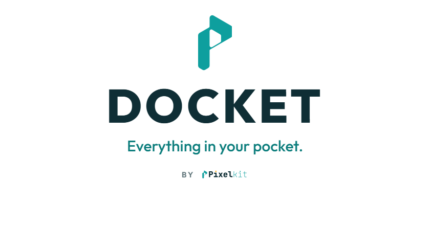
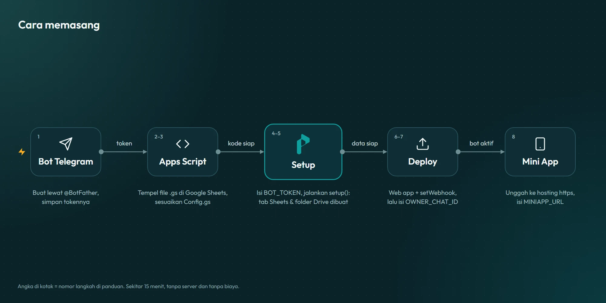
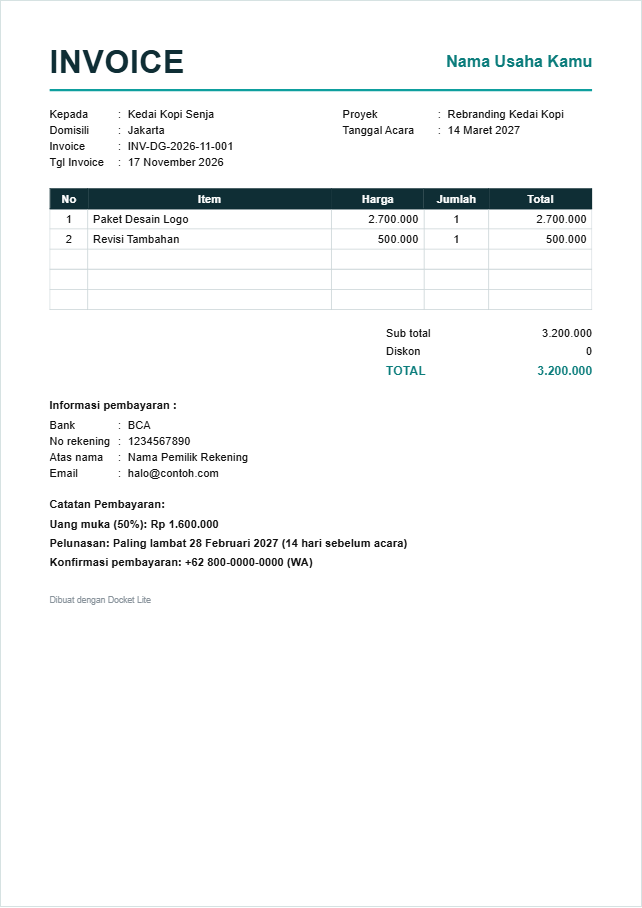
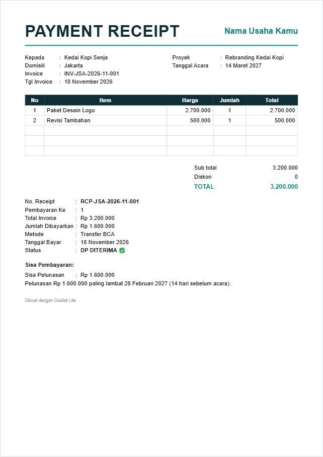
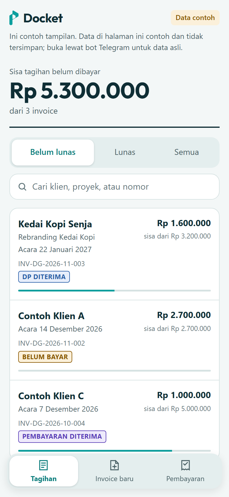
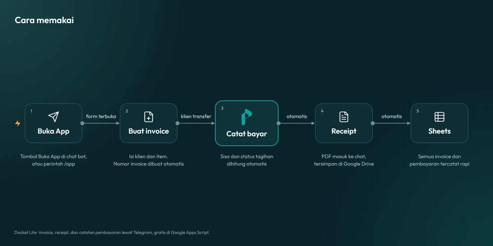
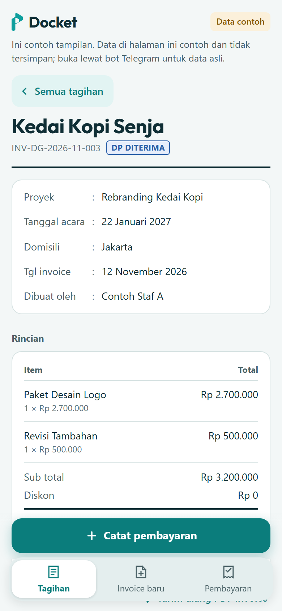
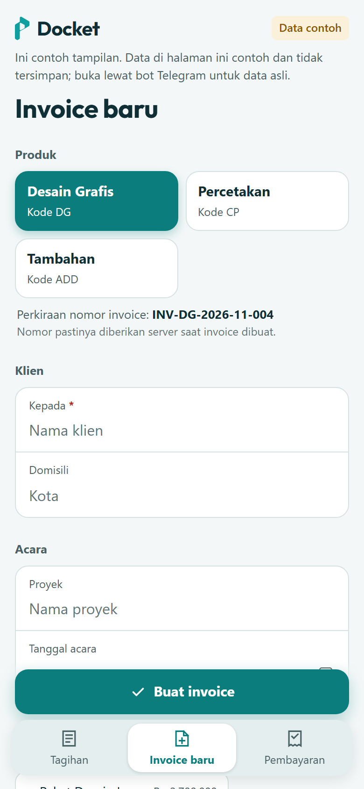
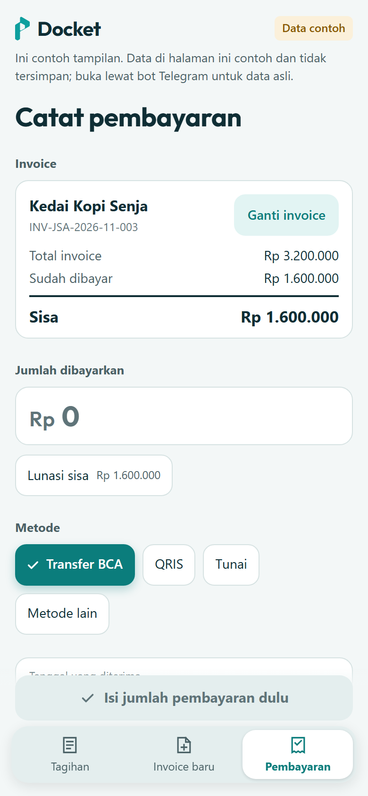
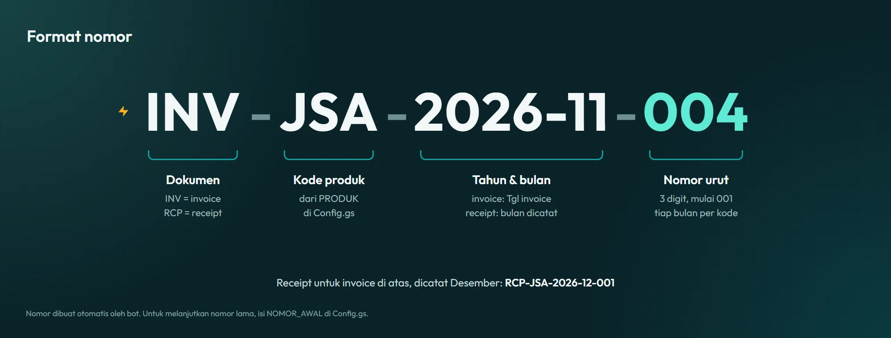

<p align="center">
  <picture>
    <source media="(prefers-color-scheme: dark)" srcset="docs/header-dark.png">
    
  </picture>
</p>

# Panduan pemasangan Docket Lite

Semua file `.gs` ada di folder [`apps-script/`](apps-script/). Pemasangan sekali jalan sekitar 15 menit,
tanpa server dan tanpa biaya: bot berjalan di Google Apps Script, data di Google Sheets milikmu.

<p align="center">
  
</p>

## 1. Buat bot Telegram
1. Di Telegram, chat **@BotFather**, kirim `/newbot`, lalu ikuti langkahnya.
2. Simpan **token** yang diberikan (bentuknya `123456789:AAH...`). Jangan dibagikan ke siapa pun.

## 2. Buat Google Sheets + Apps Script
1. Buka [sheets.new](https://sheets.new), beri nama misalnya **Docket - Invoice Log**.
2. Menu **Extensions → Apps Script**.
3. Buat file sesuai daftar di folder `apps-script/` lalu salin isinya
   (klik **+ → Script**, nama file tanpa `.gs`):
   `Config`, `Assets`, `Template`, `Parser`, `Storage`, `Telegram`, `Core`, `Api`, `Bot`, `Setup`.
   File `Code.gs` bawaan boleh dihapus.
4. **Project Settings** (ikon ⚙️) → centang *Show "appsscript.json"*, lalu salin isi
   `appsscript.json` ke file tersebut. Pastikan *Time zone* = `(GMT+07:00) Jakarta`.

## 3. Sesuaikan dengan usahamu
Buka `Config.gs` dan ubah:
- `NAMA_USAHA`, `BANK`, `EMAIL`, dan `WA`: tampil di invoice dan receipt.
- `PRODUK` dan `KODE_LIST`: kode produk untuk nomor invoice (`INV-<KODE>-<TAHUN>-<BULAN>-<URUT>`).
- `PAKET`: pilihan item cepat di Mini App. `METODE`: pilihan metode bayar.
- `DP_PERSEN` dan `PELUNASAN`: uang muka dan batas pelunasan per produk.

Logo di kop PDF: isi `LOGO_BASE64`, `LOGO_W`, dan `LOGO_H` di `Assets.gs` (petunjuk ada di file).
Kalau kosong, kop memakai `NAMA_USAHA`. Warna aksen PDF diatur lewat `WARNA_AKSEN` di `Template.gs`.

Isian di atas muncul di PDF seperti ini:

<table>
  <tr>
    <td align="center"><a href="contoh-pdf/1%20Invoice.pdf"></a></td>
    <td align="center"><a href="contoh-pdf/2%20Receipt%20DP.pdf"></a></td>
  </tr>
  <tr>
    <td align="center"><sub><b>Invoice</b>: kop dari <code>NAMA_USAHA</code> atau logo, informasi pembayaran dari<br><code>BANK</code> dan <code>EMAIL</code>, catatan dari <code>DP_PERSEN</code>, <code>PELUNASAN</code>, dan <code>WA</code></sub></td>
    <td align="center"><sub><b>Receipt</b>: jumlah dibayar, sisa tagihan, dan pengingat pelunasan</sub></td>
  </tr>
</table>

## 4. Isi Script Properties
**Project Settings → Script Properties → Add script property**:

| Property | Isi |
|---|---|
| `BOT_TOKEN` | token dari BotFather |
| `OWNER_CHAT_ID` | kosongkan dulu, diisi di langkah 7 |

## 5. Jalankan `setup()`
Pilih file `Setup`, pilih fungsi **setup**, klik **Run**, lalu beri izin (Sheets, Drive, internet).
Script membuat tab **Invoice**, **Pembayaran**, **Riwayat**, dan **Produk**, folder
**Docket - Receipt** di Google Drive, serta property `SPREADSHEET_ID`, `RECEIPT_FOLDER_ID`,
dan `WEBHOOK_KEY`.

> Ingin memakai folder Drive yang sudah ada? Isi `RECEIPT_FOLDER_ID` dengan ID folder
> (bagian setelah `/folders/` di URL) **sebelum** menjalankan `setup()`.

## 6. Deploy sebagai Web app
1. **Deploy → New deployment** → ikon ⚙️ → **Web app**.
2. *Execute as*: **Me**. *Who has access*: **Anyone**. Klik **Deploy**.
3. Salin **Web app URL** (berakhiran `/exec`), lalu tambahkan Script Property `WEBAPP_URL`.
4. Jalankan fungsi **setWebhook** dari file `Setup`.

> Setiap kali kode diubah: **Deploy → Manage deployments → ✏️ Edit → Version: New version → Deploy**.
> URL tetap sama, jadi `setWebhook` tidak perlu dijalankan ulang.

## 7. Hubungkan bot dengan akun Telegram kamu
1. Chat bot kamu di Telegram, kirim `/id`.
2. Isi Script Property `OWNER_CHAT_ID` dengan Chat ID tersebut.

Docket Lite dipakai **satu orang**, yaitu pemilik bot. Orang lain yang menghubungi bot hanya
mendapat Chat ID-nya dan tidak bisa membuat dokumen atau membuka data. Ingin dipakai bersama tim,
dengan tombol **Izinkan** untuk anggota baru? Itu ada di versi lengkap (lihat README).

## 8. Pasang Mini App
`miniapp/index.html` adalah satu file tanpa build. File ini perlu di-hosting di alamat `https://`.
Cara gratis: **GitHub Pages** atau **Cloudflare Pages / Workers**.

1. Buka `miniapp/index.html`, cari `var API_URL = '';` lalu isi dengan **Web app URL** dari
   langkah 6. URL ini aman dibagikan: setiap request dicek dengan tanda tangan Telegram dan
   hanya pemilik (`OWNER_CHAT_ID`) yang diterima.
2. Unggah ke hosting, misalnya repository GitHub baru dengan **Settings → Pages → Branch: `main`**.
3. Di Apps Script, tambahkan Script Property `MINIAPP_URL` dengan alamat tersebut.
4. Deploy **New version**, lalu jalankan fungsi **setMiniAppButton**.
5. Buka chat bot: tombol **Buka App** muncul di kiri kolom ketik. Bisa juga kirim `/app`.

<p align="center">
  <picture>
    <source media="(prefers-color-scheme: dark)" srcset="docs/screenshots/tagihan-dark.png">
    
  </picture><br>
  <sub>Halaman pertama saat Mini App dibuka. Tampilannya mengikuti tema terang atau gelap Telegram.</sub>
</p>

> Membuka `index.html` langsung di browser (di luar Telegram) menampilkan **mode demo** dengan
> data contoh, berguna untuk mengecek tampilan.

## 9. (Opsional) Rapikan tampilan Sheets
Jalankan fungsi **rapikanSheet**: judul kolom berwarna, baris selang-seling, format Rupiah, warna
status, dan filter. Aman dijalankan berkali-kali.

---

# Cara pakai

<p align="center">
  
</p>

## Lewat Mini App

<table>
  <tr>
    <td align="center" valign="top" width="25%"><picture><source media="(prefers-color-scheme: dark)" srcset="docs/screenshots/tagihan-dark.png"></picture></td>
    <td align="center" valign="top" width="25%"><picture><source media="(prefers-color-scheme: dark)" srcset="docs/screenshots/detail-dark.png"></picture></td>
    <td align="center" valign="top" width="25%"><picture><source media="(prefers-color-scheme: dark)" srcset="docs/screenshots/invoice-baru-dark.png"></picture></td>
    <td align="center" valign="top" width="25%"><picture><source media="(prefers-color-scheme: dark)" srcset="docs/screenshots/pembayaran-dark.png"></picture></td>
  </tr>
  <tr>
    <td align="center"><b>Tagihan</b><br><sub>Total sisa, saringan status, pencarian</sub></td>
    <td align="center"><b>Detail</b><br><sub>Item, riwayat bayar, kirim ulang PDF</sub></td>
    <td align="center"><b>Invoice baru</b><br><sub>Produk, klien, item, diskon</sub></td>
    <td align="center"><b>Pembayaran</b><br><sub>Jumlah atau Lunasi sisa, metode</sub></td>
  </tr>
</table>

- **Tagihan**: total sisa tagihan, saringan status, pencarian. Ketuk invoice untuk membuka **Detail**.
- **Detail**: item, riwayat pembayaran (dengan tautan receipt di Drive), dan tombol kirim ulang PDF invoice.
- **Invoice baru**: pilih produk, isi klien dan item, diskon Rp atau %. Nomor dibuat otomatis.
- **Pembayaran**: pilih invoice, isi jumlah (atau **Lunasi sisa**), pilih metode, lalu simpan.

## Lewat perintah chat
Ketik `/invoice` atau `/receipt` tanpa isi, bot membalas template yang bisa disalin.

```
/invoice
Kepada: Kedai Kopi Senja
Domisili: Jakarta
Proyek: Rebranding Kedai Kopi
Tanggal Acara: 22 Januari 2027
Kode: JSA
Item: Paket Desain Logo | 2700000 | 1
Item: Revisi Tambahan | 500rb | 2
Diskon: 0
```

```
/receipt
Invoice: INV-JSA-2026-11-004
Dibayarkan: 1350000
Metode: Transfer BCA
```

- Harga boleh ditulis `2700000`, `2.700.000`, `2,7jt`, atau `500rb`. Diskon boleh `200000` atau `10%`.
- Status dihitung otomatis: **BELUM BAYAR**, **DP DITERIMA**, **PEMBAYARAN DITERIMA**, **LUNAS**.
- `/cek` menampilkan invoice yang belum lunas; `/cek INV-...` menampilkan satu invoice.
- `/app` membuka Mini App, `/id` menampilkan Chat ID.

## Penomoran

<p align="center">
  
</p>

| Dokumen | Format | Contoh |
|---|---|---|
| Invoice | `INV-<kode>-<tahun>-<bulan>-<urut>` | `INV-JSA-2026-11-004` |
| Receipt | `RCP-<kode>-<tahun>-<bulan>-<urut>` | `RCP-JSA-2026-11-012` |

Nomor urut tiga digit, mulai dari 001 setiap bulan untuk tiap kode. Untuk melanjutkan nomor yang
sudah dipakai sebelumnya, isi `NOMOR_AWAL` di `Config.gs`.

## Kalau bot tidak merespons
- Jalankan **webhookInfo** di Apps Script dan lihat `last_error_message`.
- Pastikan kode terbaru sudah di-deploy (**New version**) dan `setWebhook` sudah dijalankan.
- Pastikan `OWNER_CHAT_ID` berisi Chat ID kamu (kirim `/id` ke bot untuk melihatnya).
