<p align="center">
  <picture>
    <source media="(prefers-color-scheme: dark)" srcset="docs/header-dark.png">
    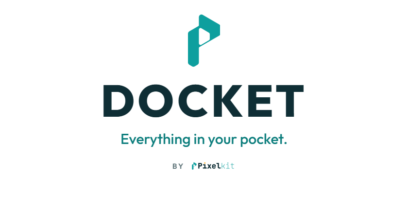
  </picture>
</p>

<p align="center">
  Invoice, receipt, dan catatan pembayaran langsung dari Telegram: bot + Mini App di Google Apps Script.<br>
  <b>Docket Lite</b> terbuka untuk dicoba, dipelajari, dan dikembangkan secara non-komersial.<br>
  Untuk dipakai menjalankan usaha, lihat <a href="#versi-lengkap">Versi lengkap</a>.
</p>

<p align="center">
  <a href="https://whoisliamm.github.io/docket/"></a>
  
  
  
  <a href="LICENSE"></a>
</p>

---

## Tampilan

<table>
  <tr>
    <td align="center" valign="top" width="25%"><picture><source media="(prefers-color-scheme: dark)" srcset="docs/screenshots/tagihan-dark.png">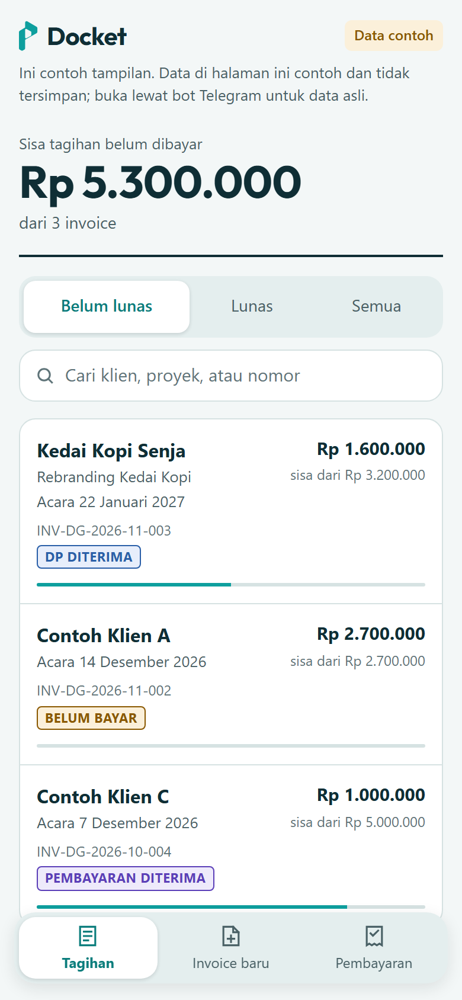</picture></td>
    <td align="center" valign="top" width="25%"><picture><source media="(prefers-color-scheme: dark)" srcset="docs/screenshots/detail-dark.png">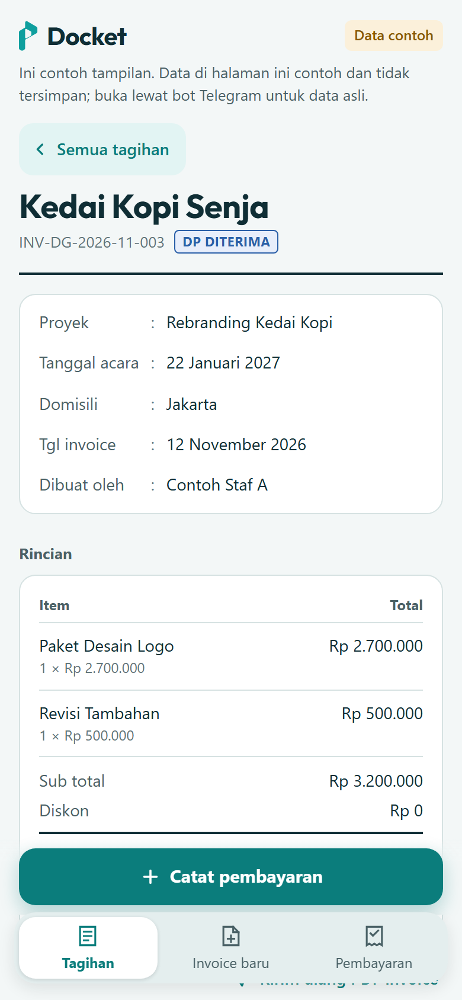</picture></td>
    <td align="center" valign="top" width="25%"><picture><source media="(prefers-color-scheme: dark)" srcset="docs/screenshots/invoice-baru-dark.png">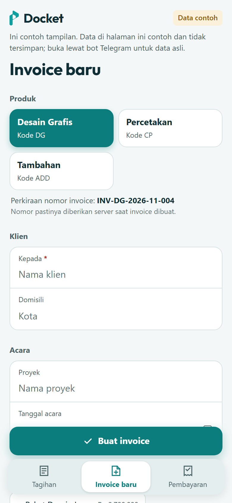</picture></td>
    <td align="center" valign="top" width="25%"><picture><source media="(prefers-color-scheme: dark)" srcset="docs/screenshots/pembayaran-dark.png">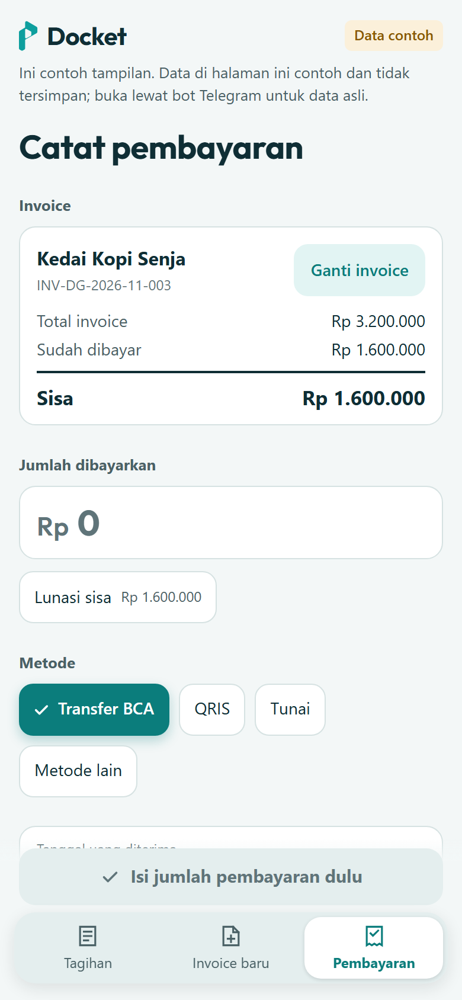</picture></td>
  </tr>
  <tr>
    <td align="center"><b>Tagihan</b><br><sub>Total sisa, saringan status, pencarian</sub></td>
    <td align="center"><b>Detail</b><br><sub>Rincian, riwayat bayar, kirim ulang PDF</sub></td>
    <td align="center"><b>Invoice baru</b><br><sub>Nomor dibuat otomatis per produk</sub></td>
    <td align="center"><b>Pembayaran</b><br><sub>Uang muka, cicilan, atau lunasi sisa</sub></td>
  </tr>
</table>

<sub>Mini App mengikuti tema terang atau gelap Telegram pengguna. <a href="https://whoisliamm.github.io/docket/">Coba demonya</a>: di luar Telegram, Mini App memakai data contoh dan tidak menyimpan apa pun.</sub>

## Cara memakai

<p align="center">
  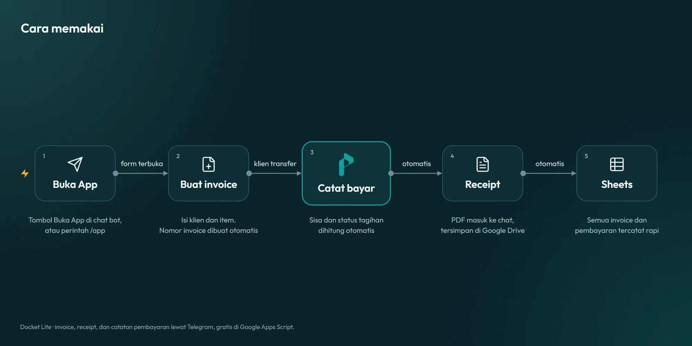
</p>

1. **Buka App** lewat tombol menu di chat bot, atau kirim `/app`.
2. **Buat invoice**: pilih produk, isi klien dan item. Nomor seperti `INV-DG-2026-11-001` dibuat otomatis, PDF-nya masuk ke chat untuk diteruskan ke klien.
3. **Catat bayar**: pilih invoice, isi jumlah dan metode. Sisa tagihan dan status dihitung otomatis.
4. **Receipt** PDF dikirim ke chat dan tersimpan di Google Drive, per bulan.
5. **Sheets**: setiap invoice dan pembayaran tercatat rapi, siap direkap.

## Fitur Docket Lite

| Fitur | Keterangan |
|---|---|
| **Invoice** | Nomor urut per produk dan bulan, diskon nominal atau persen, uang muka otomatis. |
| **Pembayaran** | Uang muka, cicilan, atau pelunasan. Status berubah sendiri: BELUM BAYAR, DP DITERIMA, PEMBAYARAN DITERIMA, LUNAS. |
| **PDF** | Invoice dan receipt dengan nama atau logo yang kamu atur, dikirim ke chat. Receipt disimpan di Drive. |
| **Mini App** | Daftar tagihan, detail, invoice baru, dan catat pembayaran tanpa mengetik format. Tema terang dan gelap. |
| **Lewat chat** | `/invoice`, `/receipt`, dan `/cek` untuk yang lebih suka mengetik. |
| **Khusus pemilik** | Bot dan Mini App hanya bisa dipakai pemiliknya. Orang lain ditolak. |

### Contoh dokumen

<table>
  <tr>
    <td align="center"><a href="contoh-pdf/1%20Invoice.pdf">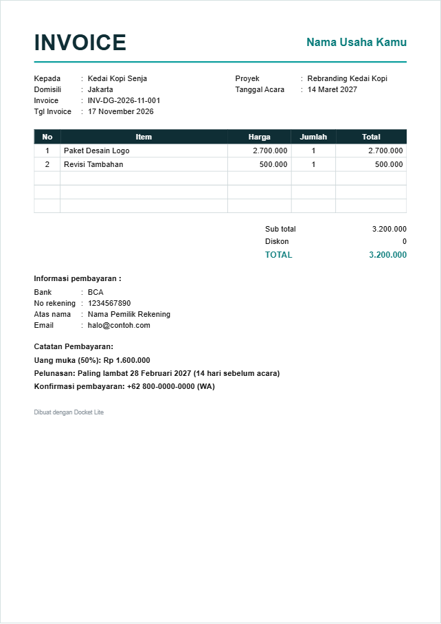</a></td>
    <td align="center"><a href="contoh-pdf/2%20Receipt%20DP.pdf">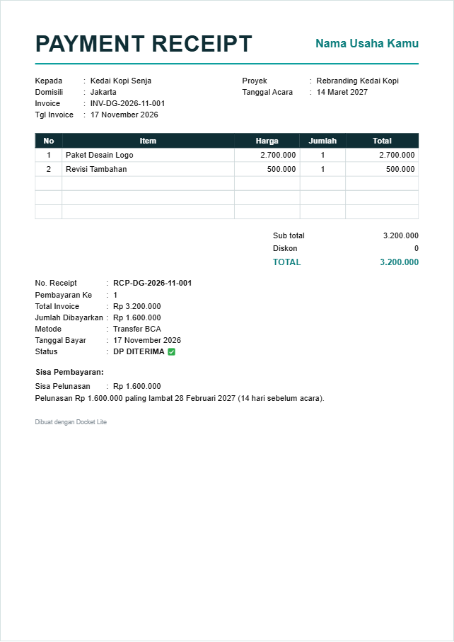</a></td>
    <td align="center"><a href="contoh-pdf/3%20Receipt%20Lunas.pdf">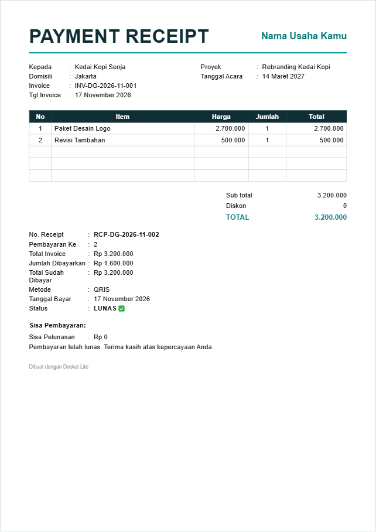</a></td>
  </tr>
  <tr>
    <td align="center"><sub>Invoice</sub></td>
    <td align="center"><sub>Receipt uang muka</sub></td>
    <td align="center"><sub>Receipt lunas</sub></td>
  </tr>
</table>

<sub>Dibuat dari kode di repo ini dengan data rekaan. Nama usaha, rekening, dan kontak diatur di `Config.gs`.</sub>

## Cara kerja

<p align="center">
  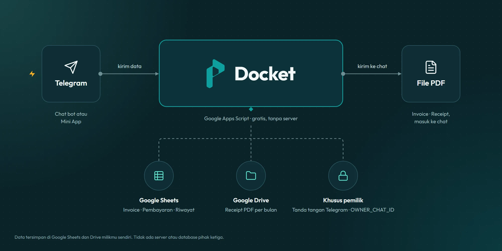
</p>

**Kenapa Google Apps Script?** Gratis, berjalan 24 jam tanpa server, dan langsung menulis ke Google
Sheets dan Drive milikmu. Tidak ada database pihak ketiga yang menyimpan data klienmu.

## Versi lengkap

Docket Lite dibuat untuk mencoba, belajar, dan pemakaian pribadi non-komersial (lihat [Lisensi](#lisensi)).
Untuk menjalankan usaha, pilih **Docket versi lengkap**: dipasang dan disesuaikan langsung oleh Pixelkit,
dengan fitur untuk tim dan lisensi komersial.

<table>
  <tr>
    <td align="center" valign="top" width="25%"><picture><source media="(prefers-color-scheme: dark)" srcset="docs/screenshots/pro-tagih-dark.png">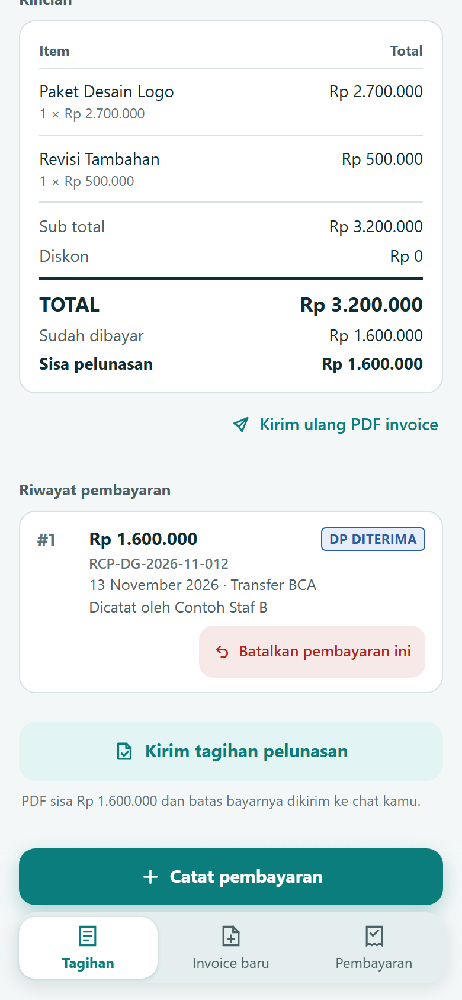</picture></td>
    <td align="center" valign="top" width="25%"><picture><source media="(prefers-color-scheme: dark)" srcset="docs/screenshots/pro-edit-dark.png">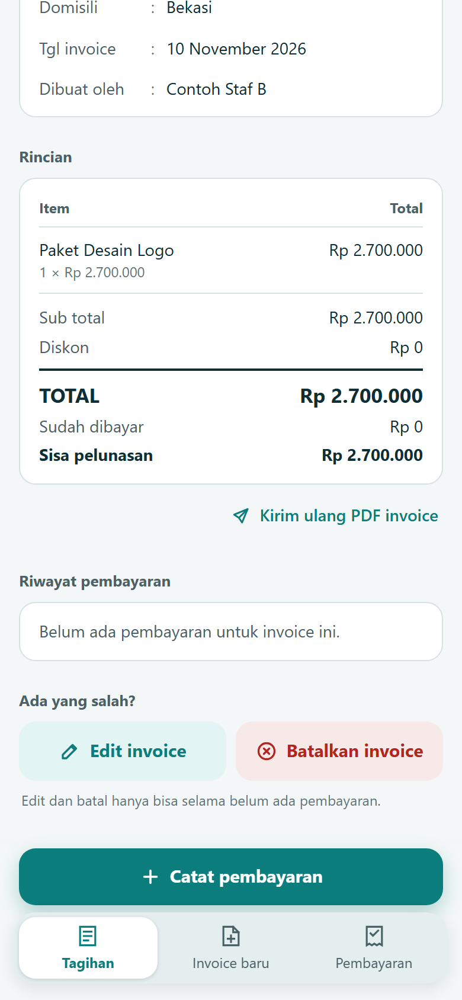</picture></td>
    <td align="center" valign="top" width="25%"><picture><source media="(prefers-color-scheme: dark)" srcset="docs/screenshots/pro-kembar-dark.png">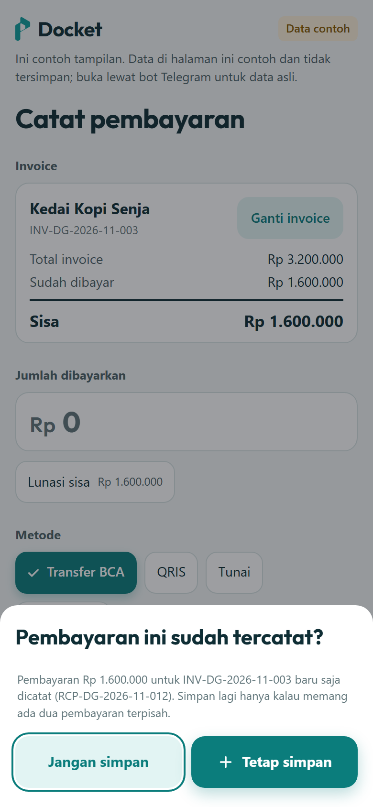</picture></td>
    <td align="center" valign="top" width="25%"><picture><source media="(prefers-color-scheme: dark)" srcset="docs/screenshots/pro-produk-dark.png">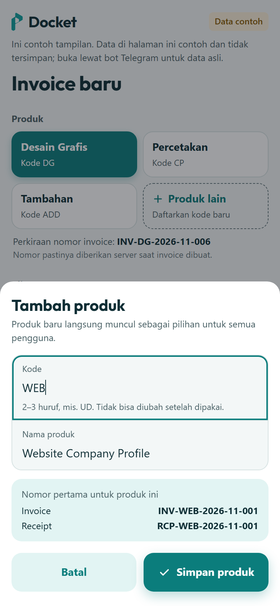</picture></td>
  </tr>
  <tr>
    <td align="center"><b>Tagihan pelunasan</b><br><sub>PDF sisa tagihan + batas bayar</sub></td>
    <td align="center"><b>Edit & batal</b><br><sub>Revisi invoice dengan riwayat</sub></td>
    <td align="center"><b>Anti catat dobel</b><br><sub>Konfirmasi pembayaran kembar</sub></td>
    <td align="center"><b>Produk baru</b><br><sub>Didaftarkan langsung dari Mini App</sub></td>
  </tr>
</table>

| | Lite (repo ini) | Versi lengkap |
|---|:---:|:---:|
| Invoice & receipt lewat chat dan Mini App | ✓ | ✓ |
| Catatan di Google Sheets, receipt di Google Drive | ✓ | ✓ |
| Status dan sisa tagihan otomatis | ✓ | ✓ |
| Desain PDF premium sesuai merek usahamu | template sederhana | ✓ |
| Edit dan batalkan invoice, batalkan pembayaran, semua tercatat di riwayat | | ✓ |
| Tagihan pelunasan (PDF) dengan batas bayar per produk | | ✓ |
| Pengingat pelunasan harian ke chat atau grup tim | | ✓ |
| Anti catat dobel saat koneksi putus | | ✓ |
| Dipakai bersama tim: anggota baru lewat tombol **Izinkan**, `/akses` untuk admin | satu pengguna | ✓ |
| Produk baru langsung dari Mini App | | ✓ |
| Dashboard Ringkasan dengan grafik di Google Sheets | | ✓ |
| Dipasang, disesuaikan, dan didampingi Pixelkit | | ✓ |

**Tertarik?** Hubungi Pixelkit untuk membeli versi lengkap atau dibuatkan tools serupa untuk usahamu:

<p align="center">
  <a href="https://wa.me/62881022081221"></a>
  <a href="mailto:auliailham007@gmail.com"></a>
  <a href="https://www.instagram.com/zenith.coffee_supplier/"></a>
</p>

<p align="center"><sub>WhatsApp 0881-0220-81221 · auliailham007@gmail.com · Instagram @zenith.coffee_supplier</sub></p>

## Isi repo

| Folder / file | Isi |
|---|---|
| [`apps-script/`](apps-script/) | Semua kode server: bot, API Mini App, PDF, Sheets. Tempel ke proyek Apps Script. |
| [`miniapp/index.html`](miniapp/index.html) | Mini App: satu file, tanpa build dan tanpa library. |
| [`docs/`](docs/) | Demo GitHub Pages dan gambar untuk README ini |
| [`contoh-pdf/`](contoh-pdf/) | PDF contoh dari kode ini |
| [`tests/`](tests/) | Tes Node.js dengan Sheets, Drive, dan Telegram tiruan |
| [`PANDUAN-PASANG.md`](PANDUAN-PASANG.md) | Panduan pemasangan dan cara pakai, langkah demi langkah |

## Mulai cepat

Butuh akun Google dan token bot dari @BotFather.

1. Buat Google Sheets baru, buka **Extensions → Apps Script**, dan tempel semua file dari [`apps-script/`](apps-script/).
2. Ubah nama usaha, rekening, kontak, dan produk di [`apps-script/Config.gs`](apps-script/Config.gs).
3. Isi **Script Properties** `BOT_TOKEN` dan `OWNER_CHAT_ID`, jalankan `setup()`, deploy sebagai **Web app**, lalu jalankan `setWebhook()`.
4. Isi `API_URL` di `miniapp/index.html`, unggah ke hosting `https://` apa pun, lalu isi `MINIAPP_URL`.

Detail setiap langkah ada di [`PANDUAN-PASANG.md`](PANDUAN-PASANG.md). Menjalankan tes (tanpa instalasi apa pun):

```bash
node tests/test.js apps-script
node tests/tes-rapikan.js apps-script
```

## Keamanan

- Token bot dan ID Sheets disimpan di **Script Properties** Apps Script, tidak pernah di kode.
- Setiap permintaan dari Mini App diverifikasi dengan tanda tangan Telegram (`initData`), dan hanya pemilik bot yang diterima.
- Webhook memakai kunci rahasia (`WEBHOOK_KEY`), jadi hanya Telegram yang bisa mengirim pesan ke bot.
- Pencatatan memakai kunci skrip, jadi dua orang yang menyimpan bersamaan tidak mendapat nomor invoice yang sama.

## Lisensi

Docket Lite memakai [PolyForm Noncommercial 1.0.0](LICENSE). Kamu boleh memakai, mempelajari, mengubah,
dan membagikannya untuk **keperluan non-komersial**: pribadi, belajar, riset, atau organisasi nirlaba.
**Pemakaian untuk usaha** (mencatat invoice dan pembayaran bisnis, atau menjualnya kembali) memerlukan
izin dari Pixelkit. Hubungi kontak di atas untuk lisensi komersial atau versi lengkap.

<sub>Ringkasan ini bukan pengganti teks lisensi; yang berlaku adalah isi [LICENSE](LICENSE).</sub>

<br>

<div align="center">
<sub>Docket by Pixelkit · © 2026</sub>
</div>
